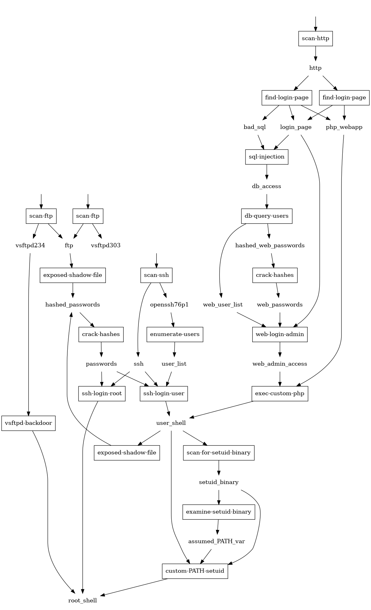

# Alpaca fork review: findings, fixes, and a roadmap

> Prepared 2026-10-02 for the `crow50/alpaca` fork of
> [`StetsonMathCS/alpaca`](https://github.com/StetsonMathCS/alpaca).
> Reviewed commit: `166f9ae` ("Added ACMSE paper"), which is also upstream's latest commit.
> Folder contents: this report, [`img/vuln-graph.png`](img/vuln-graph.png), and a re-runnable
> evidence kit in [`repro/`](repro/README.md). Nothing outside `review/` was modified.

**How to read the tags.** Each finding says how I know it:

- **[V] verified**: I ran it and saw the result. Most can be re-run with `review/repro/run.sh <check>`.
- **[R] from reading**: evident from the code or config, but not executed.
- **[?] unconfirmed**: plausible, needs a real VM build to settle.

---

## 0. Summary (read this first)

**What Alpaca is.** A research prototype (ACMSE 2019) that automates the hard part of building a
multi-step CTF target. A Prolog *planner* searches a database of 21 exploit steps and finds every chain from a
starting state to a goal (say, `root_shell`). Compatible chains are grouped into *vulnerability lattices*,
and each lattice is turned into Ansible + Packer files that build a VirtualBox VM containing exactly those
weaknesses. The lattice doubles as the instructor's answer key.

**Where it stands.** The thinking half works; the building half does not.

| Stage | Status | Evidence |
|---|---|---|
| Planner + vulnerability DB (Prolog) | **Works** on SWI-Prolog 9.0.4 (Ubuntu 24.04's apt) and 10.1.16 | [V] `[]` to `[root_shell]` yields 2 lattices in ~1.6 s |
| Vulnerability graph (`graphAllVulns`) | **Works**, and is a good design aid | [V] see section 1.3 |
| Range file generation | **Works only if run from inside `prolog/`**, not as the README says | [V] B1 |
| Ansible roles | **Broken**: 2 hard failures, 1 role that never loads, 1 likely failure | [V] B2, B3, B4; [R] B6 |
| Packer template | **Cannot start** with current Packer (404 ISO, deprecated key, missing plugins) | [V] B5 |
| The resulting VM | Only 5 of 21 steps are plausibly real; 9 have nothing behind them | [V]/[R] C2 |
| HTTP API | **Unauthenticated command injection** | [V] S1 |
| Tests / docs | 2 trivial tests; many docs describe components that were removed | [V] section 3.6 |

**Is that surprising?** Not really, and it does not contradict the paper. The authors reported a working
SQL-injection range built on their own machines. The public snapshot has since lost files (`.gitignore` swallowed at least
one, B2) and aged (ISO URL, Packer, Ubuntu 18.04). Most of what is wrong is small and fixable.

**What this means for your CTF demo.**

1. You can use Alpaca *today* as a design tool: pick a goal, see every attack chain, render the graph.
2. Getting a *built, exploitable VM* needs six small fixes (B2, B3, B5, B6, C1, S2; see section 5). Start with the goal
   `web_admin_access`: it yields **one lattice, six exploit steps, three Ansible roles** (apache, mysql, php), and
   every step of it has an implementation in the repo (currently blocked by those fixes). It is the shortest honest
   path to a demo (details in section 5).
3. Do not expose the HTTP API (`prolog/alpaca_http_api.pl`) to any network.
4. Do not hand students the range ZIP or `range_metadata.json`: they contain the answer key and passwords (S3).

**Top recommendations, in order.**

1. Fix the five blockers (B1 to B5), the database-password gap (B6), and the YAML quoting bug (C1). All small. These are PRs 1 to 6 in section 5.
2. Add a `status: implemented | stub` flag to the vulnerability database so answer keys are honest (E2).
3. Add flags, seeded reproducible generation, and a friendlier CLI (E1, E3, E4). These make it a classroom tool.
4. Write the missing docs: a Prolog primer (draft in section 1), a "how to add a vulnerability" guide, an instructor guide.
5. Add real tests and CI so the next student cannot silently break it (section 3.6).
6. Contact the original authors **before** opening the first PR (section 6). Upstream has been dormant since April 2019.

---

## 1. Alpaca in ten minutes (for someone new to Prolog)

You do not need to learn Prolog to *use* Alpaca. You need roughly an hour of pattern-copying to *add a
vulnerability*, and a few weeks to *change the planner*.

### 1.1 The pipeline

```
 you choose              Prolog (prolog/)                  generated files                 outside Prolog
+--------------+   +-----------------------+   +-------------------------------+   +-----------------------+
| start state  |   | planner   alpaca.pl   |   | ranges/<range-id>/            |   | Packer + Ansible      |
| goal state   |-->| merge     configs.pl  |-->|   range_metadata.json  (KEY!) |-->| build a VirtualBox VM |--> OVA
| parameters   |   | data  vulnDatabase.pl |   |   <lattice-id>/playbook.yml   |   | (~25 min, per paper)  |
+--------------+   +-----------------------+   |   <lattice-id>/lattice.png    |   +-----------------------+
                                               +-------------------------------+
```

**Vocabulary.**

- *State*: something the attacker knows or has (`http`, `db_access`, `user_shell`, `root_shell`...).
  The database has 21 distinct states.
- *Vulnerability*: really an **exploit step**: needs some states, gives some states, and requires certain software
  on the VM. The database has 21 of them.
- *Path*: a sequence of steps from the start state to the goal.
- *Lattice*: all the paths whose software requirements can live together on one VM. One lattice becomes one VM.
- *Config*: the software requirements, as `Role-[Key-(exists|only, [Values])]`. Each `Role` is an Ansible role.

### 1.2 Anatomy of a vulnerability

From [`prolog/vulnDatabase.pl`](../prolog/vulnDatabase.pl):

```prolog
vuln('sql-injection',            % 1. name
     [login_page, bad_sql],      % 2. needs: states the attacker must already have
     [db_access],                % 3. gives: states the attacker gains
     []).                        % 4. config: what the VM must contain (none: find-login-page already installed the app)

vuln('find-login-page', [http], [php_webapp, login_page, bad_sql],
     [ apache-[modules-(exists, ["libapache2-mod-php"])],     % Ansible role "apache", variable "modules"
       php-[deployments-(exists, ["loginpage1-badsql"])],     % role "php"
       mysql-[db-(exists, ["logindb1"]),
              root-(only, [generatePassword])] ]).            % a predicate NAME: a random password is made per range
```

Prolog reading tips: lowercase words are constants; `Capitalized` words are variables; `[a,b]` is a list;
`Key-Value` is just a pair; `%` starts a comment; every clause ends with `.`

- **`exists` vs `only`.** `exists` lists accumulate (users `jane` and `alice` can both exist). `only` pins
  a single value (`version-(only, ["2.3.4"])` conflicts with any other version). Two steps whose requirements
  conflict can never share a lattice. That is how Alpaca guarantees one VM can host everything.
- **Generated values.** A value that is a predicate name (`generatePassword`, `generateUsername`) is replaced by
  a random value at the end ([`configs.pl:83-99`](../prolog/configs.pl#L83)). That is why each range has different
  passwords.

### 1.3 How the planner thinks

[`achieveGoal`](../prolog/alpaca.pl#L42) works **backwards**: find a step that produces the goal; its needs become new goals
(minus anything already in the start state); repeat until nothing is missing; merge the configs along the way and
reject the path if they conflict. Prolog's backtracking explores every alternative automatically, which is why
"find *all* paths" is a few lines of code. The full database, as drawn by `graphAllVulns`:



Useful facts [V] (`review/repro/run.sh goals`): entry points (steps with no prerequisites) are `scan-ftp` (two variants),
`scan-ssh`, and `scan-http`. Goals and what they yield from an empty start:

| Goal | Lattices | Distinct exploit steps per lattice |
|---|---|---|
| `root_shell` | 2 | 17 and 10 |
| `user_shell` | 2 | 12 and 6 |
| `web_admin_access` | **1** | **6** (scan-http, find-login-page, sql-injection, db-query-users, crack-hashes, web-login-admin) |
| `db_access` | 1 | 3 |
| `passwords` / `hashed_passwords` | 2 each | 12 and 3 / 12 and 2 |

### 1.4 Try it (no installation beyond Docker)

```bash
docker build -t alpaca-lab review/repro                      # once; ~2 min
docker run --rm -it -v "$PWD":/repo -w /repo alpaca-lab swipl prolog/alpaca.pl
```

At the `?-` prompt (press `;` for the next answer, `.` to stop):

```prolog
?- aggregate_all(count, vuln(_,_,_,_), N).                          % N = 21
?- vuln(Name, [], Out, _).                                          % the entry points
?- createAllLatticesFromIGS([], [web_admin_access], L), length(L, N).   % N = 1
?- halt.
```

(A one-line `% Library was moved: library(http/json) --> library(json)` notice on SWI-Prolog 10.x is harmless; see U3.)

To generate a real range, **from inside `prolog/`** (see B1):

```bash
docker run --rm -v "$PWD":/repo -w /repo/prolog alpaca-lab \
    swipl main.pl createRangeFromIGS '[]' '[web_admin_access]' '[paramPasswordLength-8]'
```

The three arguments are **start state, goal state, parameters**. `paramPasswordLength` is mandatory (omitting it
fails silently, D1). Output lands in `ranges/` (git-ignored).

### 1.5 File map

| File | What it does | Verdict |
|---|---|---|
| [`prolog/main.pl`](../prolog/main.pl) | Command-line entry point | Keep; improve (E4) |
| [`prolog/alpaca.pl`](../prolog/alpaca.pl) | Planner and lattice builder | **Keep as-is**: this is the research contribution |
| [`prolog/configs.pl`](../prolog/configs.pl) | Config merging, random value generators | Keep; fix C3 |
| [`prolog/vulnDatabase.pl`](../prolog/vulnDatabase.pl) | The 21 exploit steps | Keep; add `status` (E2) |
| [`prolog/output.pl`](../prolog/output.pl) | Writes ranges, JSON, playbooks, ZIP | Keep; fix B1, C1 |
| [`prolog/graphviz.pl`](../prolog/graphviz.pl) | Draws graphs via `dot` | Keep; fix shell quoting (S1) |
| [`prolog/analysis.pl`](../prolog/analysis.pl) | Complexity / required-vuln features | **Broken** (C4): repair, don't delete |
| [`prolog/cliques.pl`](../prolog/cliques.pl) | Old multi-VM network/IP generator | Dead code (loaded by nothing); archive as seed for networking (E11) |
| [`prolog/alpaca_http_api.pl`](../prolog/alpaca_http_api.pl) | HTTP wrapper | **Insecure** (S1) |

### 1.6 Learning resources (all free)

*Learn Prolog Now!* (lpn.swi-prolog.org) for the basics; *The Power of Prolog* (metalevel.at/prolog) for
depth; swish.swi-prolog.org to experiment in a browser; the SWI-Prolog manual at swi-prolog.org.
A realistic path for a contributor: skim chapters 1 to 6 of LPN (~3 hours), then read `vulnDatabase.pl` and
`configs.pl` (~200 lines) with the REPL open.

---

## 2. How this review was done, and its limits

- Reviewed all 73 tracked files (text files read in full; the paper's text extracted; archives, images and the 419-line
  `httpd.log` checked selectively) and the full git history (2017-09-19 to 2019-04-23; 13 author identities).
- Ran experiments on a **throw-away copy** and in containers; your checkout was never written to,
  except for the new `review/` folder.
- Tools used: SWI-Prolog 10.1.16 (Debian container) and 9.0.4 (Ubuntu 24.04 `apt install swi-prolog`);
  ansible-core 2.19.11 with `community.mysql` 3.15; Packer 1.16.1 with the `virtualbox` 1.1.5 and `ansible` 1.1.6
  plugins; Graphviz 2.42.4; PyYAML 6.0.
- Read-only GitHub API calls to inspect upstream. **Nothing was written to GitHub** (no issues, PRs, or comments).
- **Not done:** I could not build a VM. VirtualBox cannot run inside WSL2, and no Ubuntu VM was available. So
  statements about what a *built* VM contains are [R] or [?]. The PHP/MySQL app was not executed. The Ansible
  failures in B2/B3 were reproduced as dry runs of the real roles.
- Docker images created on your machine: `alpaca-lab` (862 MB), `alpaca-lab-2404` (181 MB), and the pulled base image
  `swipl:latest`. Remove with `docker rmi alpaca-lab alpaca-lab-2404 swipl:latest`.

---

## 3. Findings

Severity: **BLOCKER** (cannot reach a working VM), **HIGH**, **MED**, **LOW**.
Effort: **S** under half a day, **M** 1 to 3 days, **L** a week or more. "Prolog" says whether the fix touches Prolog.

### 3.1 Blockers: a generated range cannot become a working VM

**B1. BLOCKER [V]. The README's run directory writes outside the repo and leaves broken links.**
README step 1 says to run `swipl prolog/main.pl ...` from the repo root and then `cd ranges/<id>/<lattice>/`. The code
resolves `../ranges`, `../packer`, `../ansible/roles` and `../run_packer.sh` against the **current directory**
([`output.pl:8-18, 57-69`](../prolog/output.pl#L8)). From the repo root it writes to `<parent of repo>/ranges`, the three
symlinks dangle, and `zip` prints `name not matched` for each (a warning buried among ~100 lines of output), so the ZIP
omits `roles/`, `packer/` and `run_packer.sh` (6 warnings for 2 lattices). Run from inside `prolog/`, everything works (154 entries
in the ZIP). The links
are also *absolute*, so lattice folders are not portable; only the ZIP is.
*Fix:* compute the repo root once from the source file's location, add `--out DIR`, make links relative or copy,
and check that `zip` and `dot` exist up front. **S, Prolog (small).**

**B2. BLOCKER [V]. The `mysql` role needs a template that was never committed, because `.gitignore` swallowed it.**
[`mysql/tasks/main.yml:23-27`](../ansible/roles/mysql/tasks/main.yml#L23) uses `template: src: my.cnf.j2`; no such file
exists. [`.gitignore:4`](../.gitignore#L4) is `*[0-9]`, which ignores every name ending in a digit (probably meant for old
output folders like `server_access_root40`). `git check-ignore -v` confirms it, and no commit has ever touched that path.
Ansible says `Could not find or access 'my.cnf.j2'`. It fires for every lattice that has the web app (`mysql.root` is always set).
*Fix:* delete the `*[0-9]` rule; restore the file. Ask the authors for their copy; otherwise it is likely
three lines (`[client]`, `user=root`, `password={{ mysql.root.0 }}`). **S.**

**B3. BLOCKER [V]. The database requires a web app that does not exist, and the two variants are not mutually exclusive.**
[`vulnDatabase.pl:44`](../prolog/vulnDatabase.pl#L44) deploys `loginpage1`; only `loginpage1-badsql` exists in the repo.
Worse, both `find-login-page` variants use `exists` for `php.deployments`, so they merge: even the minimal web goal
produces `deployments: [loginpage1, loginpage1-badsql]` (shown in the generated playbook). Ansible then fails with
`Could not find or access 'loginpage1.tar.gz'`. The paper's Table 1 caption says such variants are "defined in such a
way that both outcomes are not simultaneously possible"; the database does not encode that.
*Fix:* create the *patched* app (prepared statements; `Connection::run_multiple` already exists) and make the variants
exclusive with `only`. It is also a nice teaching contrast (vulnerable vs fixed). **M**, Prolog tiny.

**B4. BLOCKER [V]. The `users` role never runs, so root and user passwords are never applied.**
The file is `ansible/roles/users/tasks/tasks.yml`; Ansible loads `tasks/main.yml`. `ansible-playbook --list-tasks` shows
**0 tasks** for `users` in both lattices. Two more defects hide behind it [R]: `user: password:` expects a *crypt hash*,
not plaintext; and the second task's `when:` tests `ssh.users` / `ssh.passwords`, but the variables are `users.logins` /
`users.passwords` (the paper's own listing of this task uses `users.*`, so the repo copy regressed). Result: `ssh-login-root`
and `ssh-login-user`, the steps in nearly every generated lattice, are not realized.
*Fix:* rename to `main.yml`; `password: "{{ users.root.0 | password_hash('sha512') }}"` (add `passlib` to the prerequisites);
fix the `when:`. **S.**

**B5. BLOCKER [V]. The Packer template cannot start with current Packer.**
(a) The pinned ISO URL, `ubuntu-18.04.1-server-amd64.iso`, returns **404**; only 18.04.6 exists now
([`ubuntu_bionic.json:14`](../packer/ubuntu_bionic.json#L14)). (b) Packer 1.16.1 rejects the template:
`Deprecated configuration key: 'iso_checksum_type'`. (c) It also needs the `virtualbox` and `ansible` plugins installed
separately (`The provisioner ansible is unknown by Packer`). (d) [`setup_1.sh:9-12`](../packer/setup_1.sh#L9) hard-codes a third-party
mirror, `mirror.picosecond.org`, which gave **no answer over IPv4 within 15 s** from my network (my network has no IPv6, so I
could not test that family; I can't tell whether the mirror is gone or merely unreachable from here). Ubuntu's own
`archive.ubuntu.com` answers 200 over IPv4. Either way, a single third-party mirror is a fragile and unnecessary trust dependency. (e) Ubuntu 18.04 left standard support in May 2023.
`packer hcl2_upgrade` produced a usable draft HCL2 file, so the migration is mechanical.
*Fix:* HCL2 with `required_plugins` and `packer init`; ISO 18.04.6 with a `sha256:` checksum as a stopgap, or a newer base
(section 3.7); official mirrors. **M.**

**B6. HIGH [R/?]. The MySQL root password is never set, so the web app probably cannot reach its database.**
The `mysql_user` task that would set it is commented out
([`main.yml:15-21`](../ansible/roles/mysql/tasks/main.yml#L15)), yet the `php` role rewrites the app to log in as `root` with
`mysql.root.0`. Ubuntu's MySQL 5.7 starts with root on socket authentication [?], so the PDO connection from the web server user
would be refused. Needs a real VM to confirm. *Fix:* enable the task (use `login_unix_socket`) or create a dedicated DB
user. **S to M.**

> **Reading B2 to B4 together.** These are the classic signature of "worked on the authors' laptops": a file ignored
> by git, an artifact never committed, a role renamed mid-refactor (commit `1e230cf`). None needs redesign.

### 3.2 Correctness: builds can succeed and still not match the lattice

**C1. HIGH [V]. Everything is written into YAML unquoted, so values get silently reinterpreted.**
[`output.pl:104-108`](../prolog/output.pl#L104) prints values with `~s` and no quoting. Consequences:

- `Yes` parses as boolean `True`, and the role compares it to the string `"Yes"`
  ([`openssh/tasks/main.yml:4`](../ansible/roles/openssh/tasks/main.yml#L4)). The value is also a one-element *list*. Ansible
  **skips** the task, so root SSH login is never enabled.
- Random passwords draw from `!@#$%^&*()` and letters/digits. Measured with the real generator and formatter, parsed
  by PyYAML (what Ansible uses): **about 8% of generated passwords corrupt the playbook** (7.9 to 9.2% across six runs of 4,000 samples; about 6% fail to
  parse at all; about 2% silently become `null`; all-digit ones become integers, `0123` becomes 83). A full `root_shell` web lattice generates three
  passwords, so roughly **one build in four** is affected; the `web_admin_access` demo lattice generates one, so about one in
  twelve [both derived from the measured rate].
- `No`, `on`, `~`, and similar words would be reinterpreted the same way.

*Fix:* emit the variables with a real serializer (SWI-Prolog's JSON writer; **JSON is valid YAML**) and pass them as
`vars_files`/`-e @vars.json`. This removes the whole class of bugs. Make the roles index lists (`.0`) consistently. **S to M**, Prolog small.

**C2. HIGH [V/R]. Only 5 of the 21 exploit steps are plausibly real on a built VM.** This is the key table for anyone
designing a CTF from Alpaca. Absence was checked with `grep` across all roles and the PHP app.

| # | Step | Backed by | Status |
|---|---|---|---|
| 1 | `scan-ftp` (vsftpd 2.3.4) | `vsftpd` role installs the distro package (3.0.3); the role never reads `vsftpd.version` | MISSING |
| 2 | `scan-ftp` (vsftpd 3.0.3) | `vsftpd` role | OK [R] |
| 3 | `vsftpd-backdoor` | needs real vsftpd 2.3.4 (compile from source) | MISSING |
| 4 | `scan-ssh` | stock OpenSSH 7.6p1 (ties the DB to Ubuntu 18.04) | OK [R] |
| 5 | `ssh-login-root` | `users` + `openssh` roles | BLOCKED (B4, C1) |
| 6 | `ssh-login-user` | `users` role | BLOCKED (B4) |
| 7 | `enumerate-users` | needs unpatched OpenSSH (CVE-2018-15473); Ubuntu patched it, and the build runs `dist-upgrade` | ? likely MISSING |
| 8 | `scan-http` | `apache` role | OK [R] |
| 9 | `find-login-page` (plain) | `loginpage1.tar.gz` does not exist | MISSING (B3) |
| 10 | `find-login-page` (SQLi) | `php` role + `loginpage1-badsql` | BLOCKED (B2, B6) |
| 11 | `web-login-admin` | app login + seeded users | BLOCKED (B2) |
| 12 | `sql-injection` | string-built query at [`Access.php:12`](../ansible/roles/php/files/loginpage1-badsql/var/www/html/loginpage1-badsql/app/Models/Access.php#L12) | BLOCKED (B2, B6) |
| 13 | `db-query-users` | `home.php` prints every returned row | BLOCKED (B2, B6) |
| 14 | `exec-custom-php` | the app has no upload, eval, or exec feature | MISSING |
| 15 | `exposed-shadow-file` (from shell) | nothing makes `/etc/shadow` readable | MISSING |
| 16 | `exposed-shadow-file` (from ftp) | no FTP config exposes it | MISSING |
| 17 | `crack-hashes` (system) | offline step; random 5-char passwords are brute-force-hard (see E12) | OK, design question |
| 18 | `crack-hashes` (web) | **6 of the 12 seeded bcrypt hashes fall to a 1,500-word common-password list** [V] (`secret`, `password` x4, `12345`) | OK [V] |
| 19 | `scan-for-setuid-binary` | no planted binary | MISSING |
| 20 | `examine-setuid-binary` | no planted binary | MISSING |
| 21 | `custom-PATH-setuid` | no planted binary | MISSING |

Tally: **5 OK, 6 blocked by bugs, 9 missing, 1 unclear.** So 16 of the 21 steps would appear in a lattice's answer key
and not work on a built VM today. The planner plans with them regardless.
*Fix (cheap, honest):* add a `status` field and exclude stubs by default (E2); implement them over time (E11). **S now; L for content.**

**C3. MED [V]. The configuration-merge code deviates from the paper's rule in five edge cases.**
The two worked examples from the paper agree. These do not (`review/repro/run.sh merge`):

| Case | Code | Paper |
|---|---|---|
| `only [a,b]` + `exists [a]` (multi-valued `only`) | incompatible | compatible |
| `only [a,b]` + `only [a,b]` (a step combined with itself) | incompatible | compatible |
| `exists [a]` + `only [a,b]` | incompatible | compatible |
| `exists [a,b]` + `only [b]` | **compatible**, merged to `only [a,b]` | incompatible |
| `only []` + `exists [x]` | compatible | incompatible |

Causes: [`configs.pl:54`](../prolog/configs.pl#L54) requires an `only` union to have at most one element, and
[`configs.pl:58`](../prolog/configs.pl#L58) tests subset-ness by unifying a freshly built `union/3` result with the old list, which
depends on element *order* (`exists [a,b] + only [a]` is rejected but `+ only [b]` is accepted: same meaning, different answer).
**Latent today** (the current DB only has single-valued `only` and never mixes the two on a key), but it becomes a trap the moment an
instructor adds a vulnerability. *Fix:* a `subset/2`-based check plus unit tests that encode the paper's rule. **S, Prolog (small).**

**C4. MED [V]. Features the paper promises are broken.** `analysis.pl` calls six predicates that do not exist
(`createLatticeDirectories/3`, `getConfigs/4`, `generateLatticeInDirectory/2`, `generatePNGFromDotInDirectory/2`, `createYamlFiles/1`,
`checkVulns/2`), found with SWI-Prolog's own `list_undefined`. So *complexity-bounded lattices* (the paper's use case 3) and *must-include-a-vulnerability* (the constraint described in
its section 4.2), both documented in `docs/algos-brandon.md`, cannot run. `range_metadata.json` contains no complexity
scores, although the paper says it does. The code calls `shortestPath`/`longestPath` "BROKEN" in comments. *Fix:* repair on top of the current
data structures (E10). **M, Prolog (medium).**

### 3.3 Security

**S1. HIGH [V]. The HTTP API allows unauthenticated command injection and arbitrary file writes.**
Tested in a sealed container (no network, unprivileged user, throw-away copy). The API listens on **0.0.0.0:10333**. A
filename argument is concatenated into a shell command ([`graphviz.pl:20`](../prolog/graphviz.pl#L20), via `shell/1`), so
`["graphAllVulns", "'x; touch CANARY #'"]` created the canary file, i.e. the command ran. A path argument
writes anywhere the server user can. The file's own documented start command (`swipl -s alpaca_http_api.pl -g 'server(10333)'`)
also **fails on current SWI-Prolog** (it starts the server twice: `Address already in use`). `createStartRangeFromIGS` is
whitelisted but does not exist; the examples in `prolog/api_examples.sh` use states and signatures that no longer exist, and
`scripts/api_examples.sh` calls predicates that were removed (`createAllPaths`, `allPaths`, `createRange`). `docs/devops.md` and `scripts/alpaca_http.service` describe running it as a boot service on a server.
*Fix:* remove it, or: call `dot` via `process_create` (no shell), generate output names server-side, bind to `127.0.0.1`, add auth.
The same `shell/1` pattern in `output.pl:16` and `graphviz.pl:20` should use `process_create` regardless. **S (remove) or M (harden).**

**S2. HIGH [R]. Every finished VM ships a `vagrant` / `vagrant` account with passwordless root.**
The preseed creates it ([`preseed.cfg:33-40`](../packer/http/preseed.cfg#L33)), `setup_1.sh:25-30` grants `NOPASSWD:ALL`, OpenSSH
password login is on by default, and no step ever removes the account (`grep` for `userdel`, `passwd -l`, sudoers cleanup finds nothing). If
the exported appliance keeps it, a student can `ssh vagrant@target` and `sudo -i`, **bypassing the entire lattice**. Needs one build to confirm
[?], but nothing in the scripts removes it. *Fix:* a final provisioner removes the account and sudoers entry, regenerates SSH host keys, and clears
history. **S.**

**S3. MED [R]. The range ZIP and `range_metadata.json` are the answer key.** They contain the lattice, passwords, and
config. Distribute only the exported appliance (and a student handout). Say so in the README.

**S4. MED [R]. Supply-chain and hygiene issues.** Composer's installer is downloaded without a checksum
([`composer/tasks/main.yml`](../ansible/roles/composer/tasks/main.yml)); a third-party apt mirror (B5); `--force-yes` (deprecated);
the vulnerable web app loads Materialize and jQuery from public CDNs, so it renders unstyled in an isolated lab. The Ubuntu
base is out of standard support.

**S5. LOW [V]. A credential is committed:** `scripts/testDatabase.sh:9` sends `mimi123` for MySQL user `mimi` (a student's local account).
Remove from HEAD and make sure it is not reused anywhere. Do **not** rewrite history for this (section 6).

**S6. Operational note.** These VMs are *deliberately* vulnerable. Run them only on host-only or internal networks, never bridged
to a campus network, and check Stetson IT's policy for security-lab networks before a class exercise.

### 3.4 Usability and documentation

**D1. HIGH [V]. Failures are silent.** Upstream issue #11 (Jan 2019, "can't run alpaca") was exactly this. Tested (`review/repro/run.sh cli`):

| Mistake | Exit | What you see |
|---|---|---|
| Omit `paramPasswordLength` | 1 | nothing |
| Goal that does not exist | 1 | nothing |
| Typo in command name | 1 | nothing |
| No arguments | 1 | nothing (no usage) |
| Start/goal swapped | **0** | a "range" with one lattice, **zero** exploits and an empty playbook (a 25-minute VM build for nothing) |
| Malformed list | **0** | a Prolog syntax-error message, but exit code 0 |
| `dot` not installed | 1 | half-built `ranges/<id>/` folders, no playbooks, no ZIP |

*Fix:* validate arguments, print usage, check dependencies first, clean up on failure, return meaningful exit codes.
**S to M**, Prolog (small).

**D2. MED [V]. Contradictory usage text.** [`main.pl:9`](../prolog/main.pl#L9) says `createRangeFromIGS '[Goal]' '[InitialState]'`
and `argsToTerm` names its variables the same way, but the first argument is actually the **initial state** (the README is right).
[`alpaca.pl:7`](../prolog/alpaca.pl#L7) shows an obsolete example (`server_access_root`, a state that no longer exists). **S.**

**D3. MED [R]. README gaps.** Missing prerequisites: `zip` (the generator shells out to it), VirtualBox, the Packer plugins, the
Ansible `community.mysql` collection (I tested only with the full `ansible` package, which includes it).
`open vulns.dot.png` is macOS-only. Nothing explains the two lattices (how to choose), what to give students, or how to add a
vulnerability. `packer/README.md` still names a file that no longer exists (`ubuntu_iso_to_ovf.json`).

**D4. MED [R]. Docs describe components that are no longer in the repo.** `docs/web.md` (Spring Boot site, removed in `1ffd81d`),
`docs/ReportGenerator.md` (Java report tool), `docs/jdbcDatabase.md` (MySQL-backed vuln DB; reverted to Prolog in `31cb700`),
`docs/devops.md` (Jenkins), `docs/algorithms_HG.md` (documents `cliques.pl`, which nothing loads), and
`docs/algos-brandon.md` (documents the broken features of C4). `docs/milestone description` is an internal course note.
They are **student work with provenance worth preserving**: archive them, do not delete (section 6).

**D5. LOW [R]. `scripts/` is course scratch work.** Hard-coded `/home/noah/alpaca/devops_scripts/...` paths (that folder is
now `scripts/`), a Jenkins pipeline that cannot run, a 419-line `httpd.log` from 2018, scratch files (`apples.sh`, `qaTest.sh`,
`expectDatabase.sh`), and test files that reference predicates that no longer exist.

### 3.5 Repository hygiene

| Item | Problem | Proposal |
|---|---|---|
| [`.gitignore`](../.gitignore) | `*[0-9]` caused B2; `*.png` hides every new image (it is why `review/img/vuln-graph.png` is invisible to git; `logo.png` is tracked only because it was committed seven months before the rule, in 2018-04); missing `packer_cache/` and `output-*` | Narrow the rules |
| Root [`Vagrantfile`](../Vagrantfile) | A *generated* artifact of `cliques.pl`; targets files deleted in `f4a0c17`; box `ubuntu/trusty64` is Ubuntu 14.04 | Move to `legacy/` |
| `prolog/cliques.pl` | Loaded by nothing; hard-coded to 8 nodes; redefines `indexOf/3` differently from `analysis.pl` | Move to `legacy/` with a README; it is the seed for multi-VM networks |
| [`LICENSE`](../LICENSE) | Only the short header, not the full Apache-2.0 text, so GitHub reports the license as `NOASSERTION` [V] | Replace with the full text (ask first: section 6) |
| `ansible/roles/git` | Used by nothing | Keep or remove; ask |
| PHP app | A route to a missing `AlgorithmsController`; `new Exception` without a leading backslash inside a namespace | Small clean-up |
| Duplicate test files | `prolog/alpaca_tests.pl`, `scripts/alpaca_tests.pl`, `scripts/simple_tests.pl` | Consolidate (section 3.6) |

### 3.6 Tests and CI

Today's "suite" is two tests: a smoke test of `graphAllVulns` and `1+2 =:= 3`. `library(test_cover)` no longer exists
in SWI-Prolog 10.1 [V], the Jenkins copy cannot load `alpaca`, and the pipeline's paths are one person's home directory.

Proposed (all small, and `review/repro/` already contains seeds for the first four):

1. **Merge-rule tests** encoding the paper's compatibility rule (seed: `repro/config_merge.pl`).
2. **Planner golden tests**: `[] to [web_admin_access]` gives exactly 1 lattice with exactly these 6 steps.
3. **Playbook round-trip**: generate N playbooks, parse them with a YAML parser, assert every value survives (seed: `repro/yaml_fuzz.pl`).
4. **Missing-asset test**: every `deployments`/`db` value in the DB has a matching file under `ansible/roles/*/files/`
   (this one test would have caught B2 and B3).
5. **Lint gate**: `ansible-lint` (106 findings today: 34 YAML style, 31 module-name, 17 Jinja spacing, 12 free-form args, 3
   `risky-file-permissions`) and `packer validate`.
6. **CI**: GitHub Actions running the above in the lab container. Later, an integration test that applies the roles in a container.

### 3.7 Updates (aging dependencies)

| Item | Now | Direction |
|---|---|---|
| U1. Base OS | Ubuntu 18.04 (ISO 404; out of standard support since May 2023) | 18.04.6 as a stopgap; 22.04 or 24.04 LTS long term (needs autoinstall instead of the d-i preseed, PHP 8, MySQL 8; role and DB version-states change) |
| U2. Version-coupled states | `openssh76p1`, `vsftpd303` encode Ubuntu 18.04's package versions | Make the version a config the role *enforces*, or derive it from the base image |
| U3. SWI-Prolog | `library(http/json)` moved to `library(json)` (notice on 10.x); `test_cover` gone | `:- use_module(library(json))` with a fallback; drop `test_cover` |
| U4. Packer | JSON template | HCL2 + `packer init`, pinned plugin versions |
| U5. Ansible | Short module names, `key=value` free-form, `with_items` | FQCN (`ansible.builtin.apt`, `community.mysql.mysql_db`), `loop` (the 106 lint findings) |
| U6. Build time | ~25 min per VM, from the ISO (paper) | Golden base image + per-lattice Ansible (paper estimates 4 to 5 min) |
| U7. PHP app | PHP 7.2 era; unguarded `$_SESSION['authorized']` (warnings on PHP 8) | Update when the base OS moves |

---

## 4. Enhancements for classroom and CTF use

Ranked by value for a computer-and-network-security course. "Prolog" = touches the planner side.

| ID | Enhancement | Why it matters | Effort | Prolog |
|---|---|---|---|---|
| E1 | **Flags / proof of compromise.** `generateFlag` (the generator mechanism already exists), a `flags` role placing files at each stage, flags listed in the metadata | A CTF needs something to submit and grade; today there is none | M | small |
| E2 | **`status: implemented \| stub`** on every vulnerability; planner excludes stubs unless `--include-stubs` | Makes the answer key honest (C2) | S | small |
| E3 | **Seeded generation** (`--seed N`, e.g. a student ID) via `set_random(seed(N))` | One lattice, a distinct reproducible range per student (the paper's use case 3) | S | small |
| E4 | **A friendly CLI**: `doctor` (checks dependencies), `list-states`, `list-vulns`, `plan` (dry run: shows lattices and counts), `build --lattice N`, `--out DIR`, real errors | Removes D1 and the "which lattice?" question | M | small |
| E5 | **Instructor pack generator**: from `range_metadata.json`, write `ANSWER-KEY.md` (steps, creds, flags) and a student handout | Turns the output into something a TA can use | M | no (Python or Prolog) |
| E6 | **Golden base image** (build the OS once; per-lattice Ansible only) | 25 min to ~5 min (paper's own future work) | M | no |
| E7 | **Container backend** (Docker Compose) alongside Packer/VirtualBox | Works in WSL2 and CI; trivial multi-host networks; fast; a test harness for roles | L | no |
| E8 | **Dev container + Makefile** (`make test`, `make range GOAL=...`); seed: `repro/Dockerfile` | Students install Docker only | S | no |
| E9 | **YAML front-end for the vulnerability DB** compiled to `vuln/4`, plus a `new-vuln` scaffold (Prolog fact + role skeleton + test stub) | Lets faculty add content without writing Prolog; keeps the Prolog engine untouched | L | small |
| E10 | **Weights and complexity** in metadata; `--min/--max-complexity`, `--require`, `--exclude` (repair `analysis.pl`) | Implements what the paper describes (C4) | M | medium |
| E11 | **Course-aligned content**: host/port discovery; subnets + firewalls (seed: `cliques.pl` IP assignment); cleartext protocols; SNMP defaults; SMB/NFS shares; DNS zone transfer; ARP spoofing; iptables; TLS misconfig; web XSS/LFI/upload (an honest `exec-custom-php`); the missing items from C2 | The content is what makes it useful for *this* class, and each item is a good student project | L (ongoing) | small each |
| E12 | **Password policy**: dictionary-based passwords for crackable steps; avoid shell-special characters | A 5-char random password over 72 symbols is a brute-force exercise, not a class one; typing `X*0zH` into a terminal is no fun | S | small |
| E13 | **Isolation kit**: host-only network preset, snapshot/reset script, lab-network guidance | Safety for a shared lab (S6) | S to M | no |
| E14 | A web UI (the paper's future work; the removed Spring app is described in `docs/web.md`) | Convenience; **ask the authors whether the source still exists** | L | no |

---

## 5. Roadmap

Each bullet is one small, reviewable PR. PR 1 to 3 are the safest first contributions.

**Phase 0: housekeeping (a day).** Contact the authors (section 6). Create the working branch structure. Add `CITATION.cff` and `CONTRIBUTING.md`.

**Phase 1: make it true (1 to 2 weeks part-time).** Fixes only; no new features.

| PR | Branch | Contents | Fixes |
|---|---|---|---|
| 1 | `docs/truthful-readme` | Correct run directory and prerequisites; link the primer | D2, D3 |
| 2 | `fix/gitignore-and-assets` | Narrow `.gitignore`; restore `my.cnf.j2`; add the patched `loginpage1`; make variants exclusive | B2, B3 |
| 3 | `fix/paths-and-cli-errors` | Location-independent paths; dependency checks; usage and error messages; exit codes | B1, D1 |
| 4 | `fix/ansible-roles` | `users/main.yml` + password hash; root-SSH condition; DB password; **JSON vars file** | B4, B6, C1 |
| 5 | `chore/packer-hcl2` | HCL2, plugins, ISO, official mirrors, remove the build account | B5, S2, U4 |
| 6 | `security/http-api` | Remove the API (or harden it); stop using `shell/1` with user input | S1 |
| 7 | `test/plunit-and-ci` | Section 3.6 items 1 to 5, Actions workflow | C3 tests |
| 8 | `chore/legacy-archive` | `git mv` stale docs, scripts, `cliques.pl`, `Vagrantfile` into `legacy/` with a README (separate commit, preserves blame) | D4, D5 |

**Definition of done for Phase 1:** the `web_admin_access` lattice builds a VM on a real host, and a person can complete the
SQL-injection, hash dump, crack, and admin-login chain against it.

**Fastest honest demo.** Target `web_admin_access` (1 lattice, 6 steps, roles apache + mysql + php). It needs only B2, B3, B5,
B6, the C1 quoting fix for the MySQL password, and S2. It does *not* need the `users`, `openssh`, or `vsftpd` roles. Caveats: I
could not build it; VirtualBox cannot run inside WSL2, so run Packer on a Windows, macOS, or Linux host with VirtualBox (not tested
by me). A pragmatic stopgap is to stand up the PHP app and the seeded `logindb1.sql` in two containers by hand (also untested).

**Phase 2: make it teachable (1 to 2 weeks).** Primer + "add a vulnerability" + instructor guide (section 1 is a draft); dev container (E8); E2.

**Phase 3: make it classroom-ready (a semester project).** E1, E3, E4, E5, E12, E13, then E6 or E7.

**Phase 4: grow it (ongoing, good student projects).** E9, E10, E11, E14; publish results.

---

## 6. Contributing back without overwriting the original authors

Upstream facts [V]: last push **2019-04-23**; 23 stars, 16 forks; 0 open issues or PRs; the 10 closed PRs are all from 12 to 14
Sept 2018 and each adds a student's name to the README (it looks like a class exercise; `docs/milestone description` says the
instructor graded with `git blame`). One issue (#11, 2019) got a same-month reply from J. Eckroth, the paper's first
author. Your fork's `master` equals upstream's `master`.

**Credit and history**

- Keep `master` identical to `upstream/master`; do all work on topic branches; **never force-push or rewrite shared history**.
- One concern per PR, small diffs. **Do not reformat the authors' Prolog wholesale**, and do file moves with `git mv` in their
  own commit so `git blame` still points at the authors (this was an explicit course value).
- Keep the README's "Publications" section and the authors' docs. Archive rather than delete (`legacy/` + a README explaining
  provenance). Add, don't replace: a "Maintainers and contributors" section, a `CITATION.cff` crediting the paper's four authors, and
  your name beside theirs. The git history shows 13 author identities; preserve all of them.
- The planner (`alpaca.pl`, `configs.pl`) and the database format stay the source of truth. Anything new (YAML front-end,
  container backend) is **additive**.

**License.** The LICENSE is Apache-2.0 (header only; the copyright holder is Stetson University, Math/CS Department). Keep every
copyright notice; propose adding the full license text (so GitHub detects it); modified files should state they were changed (git
history plus a short NOTICE usually does it). Ask the department if unsure.

**Process**

1. **Talk to the authors first.** You are in the same department. Share this report, and ask the questions in section 7. Offer the PR
   sequence in section 5 and ask whether they prefer PRs, or want to add you as a maintainer.
2. **Open an upstream issue** ("Proposal: reviving Alpaca for the security curriculum") linking the plan, *before* the first PR.
3. Send PR 1 and 2 (docs and small fixes) first; they are easy to review and build trust.
4. **Plan B:** upstream is dormant. If nobody responds, the fork becomes the maintained line with a prominent "forked from" note
   and the same attribution, and you keep offering PRs upstream.

---

## 7. Questions for the original authors

1. Do you still have `ansible/roles/mysql/templates/my.cnf.j2` and `loginpage1.tar.gz` locally? (B2, B3)
2. Issue #11 mentions fixes kept in a **private repo**. Is anything still there (including the web UI described in `docs/web.md`)?
3. Was a full VM ever built from the *current* public snapshot? What Packer, Ansible, and VirtualBox versions? Did `enumerate-users` and
   `vsftpd-backdoor` ever work on a built VM? (C2)
4. Is `vsftpd` 2.3.4, a setuid PATH binary, or an upload feature anywhere on someone's disk?
5. May the LICENSE be replaced with the full Apache-2.0 text? And is the department comfortable with `legacy/` archiving of the student work in `docs/` and `scripts/`?
6. Do you want PRs, or would you add the fork's owner as a maintainer?

---

## Appendix A: Evidence log

Rows whose method names a `repro` check can be re-run with `review/repro/run.sh <check>`. The rest need the network or
heavy tools and were run by hand (the commands are shown).

| Claim | How verified | Result |
|---|---|---|
| Planner works on modern SWI-Prolog | Ubuntu 24.04 `apt install swi-prolog` (9.0.4) by hand; 10.1.16 via `repro goals` | README steps 0 and 1 succeed from `prolog/`; 2 lattices for `root_shell` |
| B1 wrong run directory | `repro readme` | writes to `/tmp/ranges` (outside the copy); 6 zip warnings; from `prolog/` 154 ZIP entries |
| B2 missing template | `repro ansible`; `git check-ignore -v`; `git log --all` | `.gitignore:4:*[0-9]`; 0 commits; Ansible `Could not find or access 'my.cnf.j2'` |
| B3 missing app | `repro ansible` | `Could not find or access 'loginpage1.tar.gz'`; deployments list contains both |
| B4 `users` role empty | `repro ansible` | `role users -> 0 task(s) loaded` in both lattices |
| B5 Packer | `curl -I` ISO; Packer 1.16.1 `validate` | 404; `Deprecated configuration key: 'iso_checksum_type'`; `ansible` provisioner unknown without plugin |
| B5 mirror | `curl -4 -m 15` (and `-6`) | IPv4: no response (timeout, exit 28); IPv6 untestable from my network; official archive: 200 |
| C1 YAML | `repro yaml` (2 x 4,000 samples per run; six runs in total) | 7.9 to 9.2% corrupt; `Yes` becomes `True`; root-SSH task `skipping` |
| C2 missing steps | `grep` of all roles and the PHP app for setuid, shadow, anonymous FTP, 2.3.4, eval/exec/system | no matches |
| C2 hash crackability | bcrypt vs the top 1,500 of John the Ripper's list | 6 of 12 cracked |
| C3 merge | `repro merge` | 5 differences from the paper's rule |
| C4 broken features | `repro undefined`; metadata keys | 6 undefined predicates; no complexity in JSON |
| S1 API | `repro api` (sealed container) | binds 0.0.0.0; canary created; file written outside the working dir; documented start command fails |
| D1 silent failures | `repro cli` | table in D1 |
| Lint | `ansible-lint` 25.6 on `ansible/roles` | 106 findings |
| Upstream state | GitHub API (read-only) | last push 2019-04-23; license `NOASSERTION`; 10 closed PRs; 1 closed issue |

## Appendix B: Disposition of every tracked path

| Path | Action |
|---|---|
| `prolog/{main,alpaca,configs,vulnDatabase,output,graphviz}.pl` | Keep; targeted fixes only |
| `prolog/analysis.pl` | Keep; repair (E10) |
| `prolog/cliques.pl`, root `Vagrantfile`, `docs/algorithms_HG.md` | Archive to `legacy/` (seed for E11) |
| `prolog/alpaca_http_api.pl`, `prolog/api_examples.sh`, `scripts/api_examples.sh`, `scripts/alpaca_http.service`, `scripts/run_http_server.sh`, `scripts/check_http_server.sh` | Remove or harden; archive the rest |
| `prolog/alpaca_tests.pl`, `scripts/alpaca_tests.pl`, `scripts/simple_tests.pl` | Replace with a real plunit suite |
| `scripts/` (everything else), `docs/{web,ReportGenerator,jdbcDatabase,devops}.md`, `docs/milestone description` | Archive to `legacy/` with a provenance README |
| `docs/algos-brandon.md` | Keep; update when C4 is fixed |
| `ansible/roles/{apache,composer,openssh,php,vsftpd}` | Keep; fix per B3/B6/C1/U5 |
| `ansible/roles/mysql` | Keep; add the template (B2), enable the password task (B6) |
| `ansible/roles/users` | Keep; rename `tasks.yml` to `main.yml`, hash the password (B4) |
| `ansible/roles/git` | Unused: keep or remove (ask) |
| `ansible/roles/php/files/loginpage1-badsql{,.tar.gz}` | Keep; add the patched sibling; stop shipping both the folder and the tarball by hand (generate the tarball) |
| `packer/*`, `run_packer.sh` | Migrate to HCL2 (B5, S2); update README |
| `publications/acmse-2019-alpaca.pdf`, `logo.png`, `README.md` Publications section | Keep untouched |
| `LICENSE` | Add the full text (ask first) |
